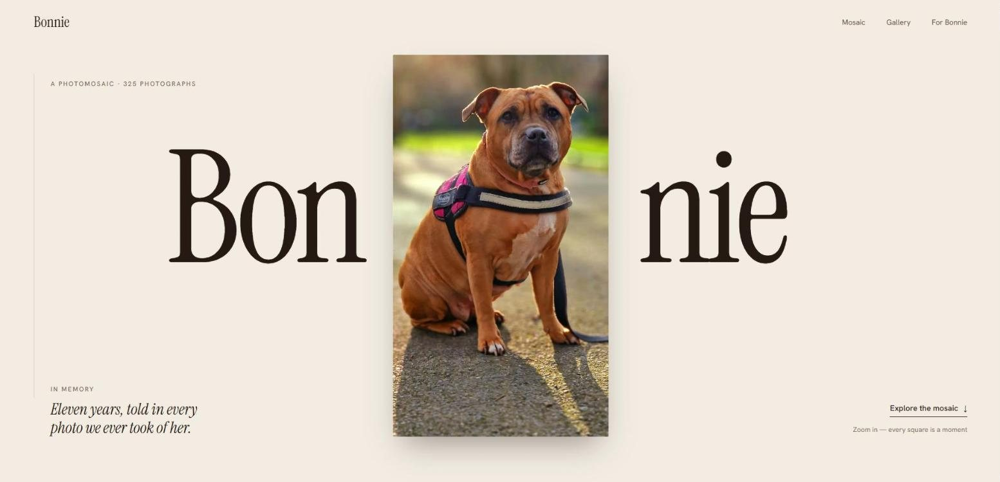
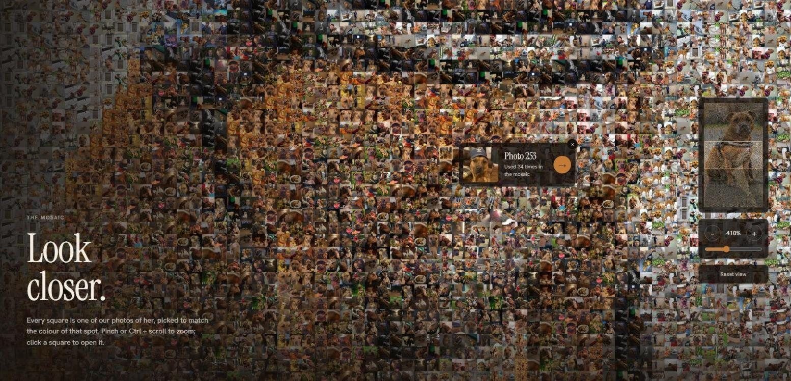
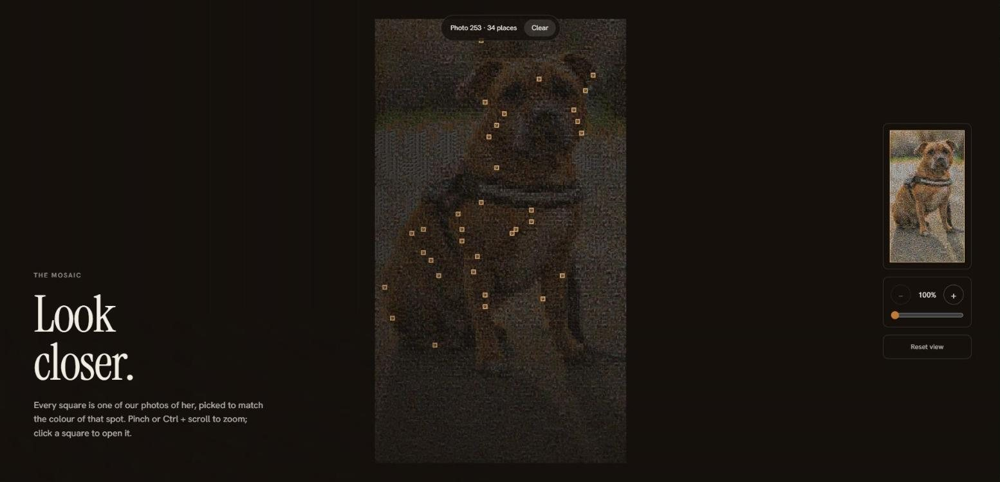
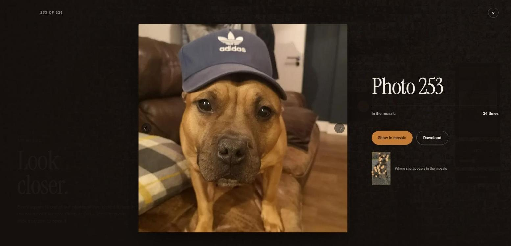
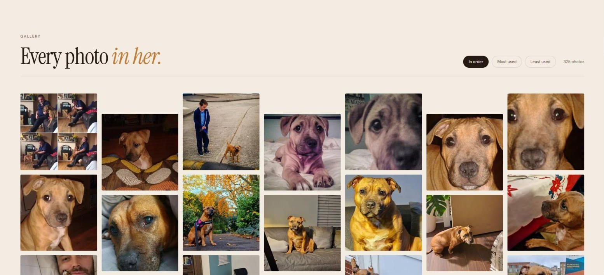
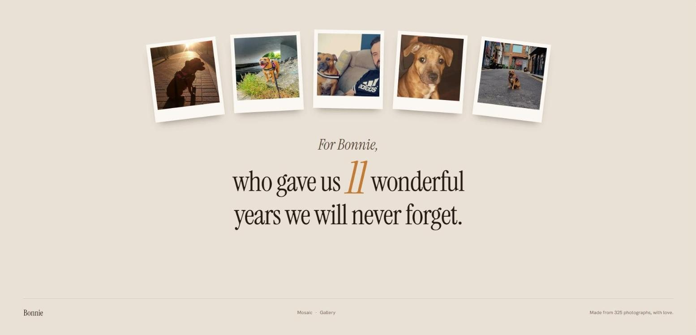
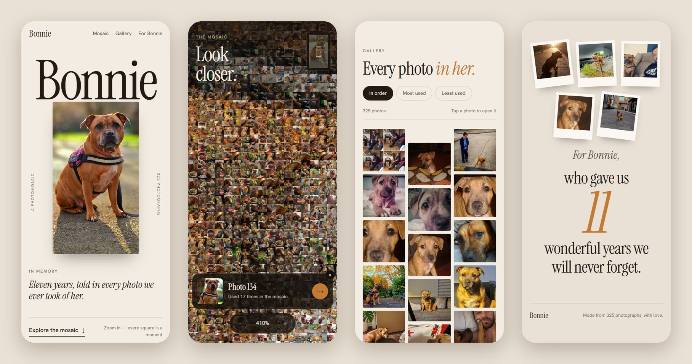

<div align="center">

# Bonnie Photomosaic

### For Bonnie, who gave us 11 wonderful years we will never forget.

A portrait of her recreated from **325 photos of her**, each placed by closest colour,
and a gallery of every one of those photos.


### [for-bonnie.vercel.app](https://for-bonnie.vercel.app)

[](https://github.com/DublinNico/for-bonnie/actions/workflows/ci.yml)      

</div>

---

## Contents

[What's on the site](#whats-on-the-site) · [Screenshots](#screenshots) · [Tech stack](#tech-stack) · [How it works](#how-it-works) · [Project layout](#project-layout) · [Running it locally](#running-it-locally) · [Tests](#tests) · [Checks and deployment](#checks-and-deployment) · [License](#license)

## What's on the site

| Section | What you can do |
|---|---|
| **Hero** | The original portrait of Bonnie between a split "Bon \| nie" title |
| **Mosaic explorer** | Zoom from the whole portrait right down to the individual photos. Drag to pan; pinch, Ctrl + scroll or the buttons to zoom. Tap any square to see which photo it is and how many times it's used. |
| **How it was made** | Portrait, then a grid of single colours, then the finished mosaic |
| **Gallery** | All 325 photos, sortable by order, most used or least used |
| **Photo view** | Full size, next / previous, download, a mini-map of everywhere the photo appears, and **Show in mosaic**, which lights up each of those places |
| **Dedication** | With a row of polaroids |

Works on desktop and phones.

## Screenshots



<table>
  <tr>
    <td width="50%">
      
      <br><sub><b>Mosaic explorer:</b> zoom in to the real photos; tap a square to see which one it is</sub>
    </td>
    <td width="50%">
      
      <br><sub><b>Show in mosaic:</b> lights up every place a photo is used</sub>
    </td>
  </tr>
  <tr>
    <td width="50%">
      
      <br><sub><b>Photo view:</b> full size, next / previous, download, and where it appears</sub>
    </td>
    <td width="50%">
      
      <br><sub><b>Gallery:</b> all 325 photos, sortable by order or how often they're used</sub>
    </td>
  </tr>
</table>



<details>
<summary><b>On phones</b></summary>
<br>

</details>

## Tech stack

| Area | Technology |
|---|---|
| **Website** | [Next.js](https://nextjs.org) 16.4 (App Router, fully static) · [React](https://react.dev) 19.3 · [TypeScript](https://www.typescriptlang.org) 5.9 · [Tailwind CSS](https://tailwindcss.com) 4.3 · HTML `<canvas>` for the mosaic explorer |
| **Image pipeline** | [Python](https://www.python.org) 3.12 · [Pillow](https://python-pillow.org) 13 (colour matching, WebP images, favicon) |
| **Runtime** | [Node.js](https://nodejs.org) 24 (locally, in CI and on Vercel) |
| **Testing** | [pytest](https://pytest.org) + pytest-cov · [Vitest](https://vitest.dev) 5 + [React Testing Library](https://testing-library.com/docs/react-testing-library/intro) + happy-dom · [Supertest](https://github.com/ladjs/supertest) · [Playwright](https://playwright.dev) 1.65 · [Artillery](https://www.artillery.io) 2 |
| **Code quality** | ESLint 10 · TypeScript type checking · `npm audit` · `pip-audit` |
| **CI and hosting** | GitHub Actions · Dependabot · CodeRabbit · [Vercel](https://vercel.com) |

## How it works

### Building the mosaic

- A Python pipeline (`bonnie.py`, built with Pillow) works out the average colour of every tile photo and of every cell in the target image, using the `.resize((1, 1))` trick with `LANCZOS` resampling for accuracy.
- Each cell gets the tile with the closest colour (squared RGB distance).
- A usage penalty (`REPEAT_PENALTY`) stops any one tile being picked too often, and a spatial cooldown stops the *same* tile reappearing near where it was last used, so there's no visible clumping.
- Tiles are cached after their first resize, so repeat picks skip the extra work.

### From mosaic to website

The mosaic always comes out the same for the same photos and settings, so nothing runs on a server per visit. Everything is computed once, locally, and the site is fully static:

1. **`bonnie.py`** builds the mosaic (65 × 115 = 7,475 cells) and writes the layout, which photo goes in each cell, to `site/public/mosaic.json`. It also saves the full-size `mosaic_output.jpg`.
2. **`make_web_assets.py`** turns 185 MB of original photos into 37 MB of WebP images at three sizes (96, 400 and 1000 px), plus the preview, portrait and colour-grid images the page uses.
3. **The website** (`site/`) reads `mosaic.json` at build time. The explorer draws the mosaic on a `<canvas>` and only paints the squares on screen: the small preview when zoomed out, then the real photos, sharper the further you zoom.
4. **`make_favicon.py`** draws the site's icon: a serif "B" with an amber mosaic tile.

## Project layout

```
bonnie.py              build the mosaic + export site/public/mosaic.json
make_web_assets.py     make the web-sized images in site/public/
make_favicon.py        make the favicon set in site/app/
rename_tiles.py        one-off: rename photos to tile_001.jpg, tile_002.jpg, ...
square_images/         the 325 original tile photos            (not in git)
target_photo/          the portrait the mosaic recreates       (not in git)
site/                  the website (Next.js 16), see site/README.md
docs/                  preview image, screenshots, design mockups, testing docs, bug reports
BUILD_GUIDE.md         how the mosaic is built, explained step by step
TODO.md / PROGRESS.md  checklist and current status
```

## Running it locally

**The website** needs Node.js 24:

```bash
cd site
npm install
npm run dev        # http://localhost:3000
```

**Rebuilding the mosaic** after changing photos or settings needs Python 3.12:

```bash
python -m venv venv
venv\Scripts\activate          # Windows  (macOS/Linux: source venv/bin/activate)
pip install -r requirements-dev.txt

python bonnie.py               # mosaic + site/public/mosaic.json
python make_web_assets.py      # web images in site/public/
```

## Tests

| Suite | Command | What it covers |
|-------|---------|----------------|
| Python (UT-###) | `python -m pytest` (project root, venv active) | mosaic matching, web images, favicon, renaming, the real data files |
| Unit (FT-###) | `npm test` in `site/` | explorer maths, data loader, every component, app state |
| Integration (IT-###) | `npm run test:integration` | the production build over HTTP: every URL, bad requests, private files, headers, CORS |
| Security (ST-###) | `npm run test:security` | injection, XSS, no login / tokens / admin, no secrets in browser files |
| End-to-end (ET-###) | `npm run test:e2e` | real-browser journeys on desktop and a 375 px phone |
| Load (Artillery) | `npm run test:perf` | page load, gallery burst, 60 s soak and bad traffic, with p95 limits |

Coverage: `npm run test:coverage` in `site/`, or `python -m pytest --cov --cov-branch`.

### Testing results

From the full run on 2026-11-08 (raw output in [`docs/testing/results/`](docs/testing/results/)):

| Suite | Result | Coverage |
|-------|--------|----------|
| Python | ✅ 50 passed | 100% of statements and branches in every function (97% per file; the misses are the `if __name__ == "__main__"` launch lines) |
| Unit | ✅ 61 passed | 73.67% statements, 67.24% branches (canvas drawing and pinch need a real browser, so they're covered end-to-end) |
| Integration | ✅ 21 passed, 1 known issue | |
| Security | ✅ 15 passed | |
| End-to-end | ✅ 28 passed, 10 skipped by design (phone-only and desktop-only checks) | |
| Load | ✅ 4 / 4 scenarios within their p95 limits, 0 failed visitors | |
| Manual | ✅ 14 test cases: equivalence partitioning, boundary values, white-box | |

Testing found **seven real bugs**. Six are fixed and covered by tests; one is a harmless local-only quirk, documented and accepted:

| # | Bug | Status |
|---|---|---|
| 1 | The hero title blocked clicks on "Explore the mosaic" on desktop, on the live site (found by the end-to-end tests) | Fixed |
| 2 | `rename_tiles.py` could overwrite a photo | Fixed |
| 3 | `bonnie.py`'s `main()` ignored changed settings | Fixed |
| 4 | No security headers, and the server advertised Next.js | Fixed |
| 5 | Next.js 16.3.1 had critical security advisories | Fixed |
| 6 | The local server answers 500 instead of 405 to write requests (the live site answers 405) | Accepted |
| 7 | The CI type check failed on a clean machine | Fixed |

**Full write-up**

- 📄 [Testing report](docs/testing/TestingReport.md): test plan, black-box and white-box design, results, coverage, conclusions, requirements traceability
- 🧪 [Manual test cases](docs/testing/test-cases/): TC-BB-EP, TC-BB-BVA and TC-WB, each with its recorded result
- 🐞 [Bug reports](docs/bugs/): BUG-001 to BUG-007
- ✅ [Testing checklist](docs/TESTING_TODO.md): every test area with its IDs

## Checks and deployment

| Tool | What it does |
|---|---|
| **CI** | GitHub Actions (`.github/workflows/ci.yml`) runs three jobs on every pull request: **backend** (Python tests with coverage, `pip-audit`, a production `npm audit`, integration and security tests), **frontend** (lint, type check, unit tests with coverage, `npm audit`) and **e2e** (Playwright; results are uploaded if it fails) |
| **Dependabot** | Weekly update PRs for npm, Python and the CI actions (`.github/dependabot.yml`) |
| **Vercel** | A preview of every PR; the live site deploys whenever something is merged into `main` |
| **CodeRabbit** | Reviews the code; images and generated files are skipped (`.coderabbit.yaml`) |
| **Security** | Standard security headers on every response (`site/next.config.ts`) |

## License

The code in this repository is licensed under MIT.

The tile and target photos in this repo are personal photos (of Bonnie, family and friends) and are **not** covered by the MIT license. They're included only so the app can function, not for reuse or redistribution.
