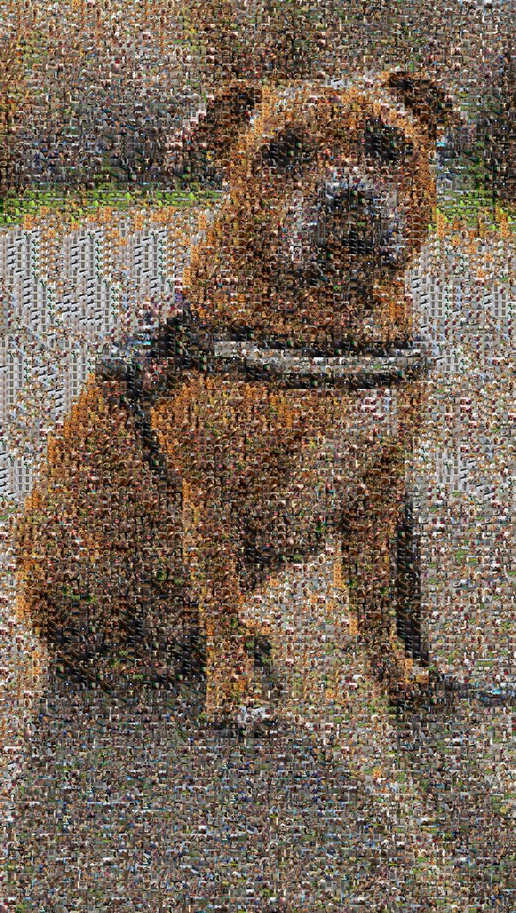

# Bonnie Photomosaic

# Dedicated to Bonnie who gave us 11 wonderful years we will never forget. 

A memorial website for Bonnie: a portrait of her recreated from 325 smaller photos of her, each picked by closest average colour match — and a gallery of every one of those photos.

**Live site:** https://for-bonnie.vercel.app



## What's on the site

- **Hero** — the original portrait of Bonnie between a split "Bon | nie" title
- **Mosaic explorer** — zoom from the whole portrait right down to the individual photos (drag to pan; pinch, Ctrl + scroll or the buttons to zoom). Tap any square to see which photo it is and how many times it's used.
- **How it was made** — portrait → grid of single colours → finished mosaic
- **Gallery** — all 325 photos, sortable by order, most used or least used
- **Photo view** — full size, next/previous, download, a mini-map of everywhere the photo appears, and **Show in mosaic**, which lights up each of those places
- **Dedication** — with a row of polaroids

Works on desktop and phones.

## How it works

- A Python pipeline (`bonnie.py`, built with Pillow) computes the average colour of every tile photo and of every cell in the target image, using the `.resize((1, 1))` trick, with `LANCZOS` resampling for accuracy.
- Each target cell is matched to the tile with the closest colour (squared RGB distance).
- A usage-count penalty (`REPEAT_PENALTY`) discourages any one tile from being picked too often, and a spatial cooldown further discourages the *same* tile from reappearing near where it was last used, to avoid visible clumping.
- Matched tiles are cached after their first resize so repeat picks skip redundant decode/resample work.

### From mosaic to website

The mosaic always comes out the same for the same photos and settings, so there's no server doing work on each visit — everything is computed once, locally, and the site is fully static:

1. **`bonnie.py`** builds the mosaic (65 × 115 = 7,475 cells) and writes the layout — which photo goes in each cell — to `site/public/mosaic.json`. It also saves the full-size `mosaic_output.jpg`.
2. **`make_web_assets.py`** turns the 185 MB of original photos into 37 MB of web-sized WebP images at three sizes (96 / 400 / 1000 px), plus the preview, portrait and colour-grid images the page uses.
3. **The website** (`site/`, Next.js) reads `mosaic.json` at build time. The explorer draws the mosaic on a `<canvas>`, only painting the squares on screen: the small preview image when zoomed out, then the real photos — sharper ones the further you zoom.
4. **`make_favicon.py`** draws the site's icon (a serif "B" with an amber mosaic tile).

## Project layout

```
bonnie.py              build the mosaic + export site/public/mosaic.json
make_web_assets.py     make the web-sized images in site/public/
make_favicon.py        make the favicon set in site/app/
rename_tiles.py        one-off: rename photos to tile_001.jpg, tile_002.jpg, ...
square_images/         the 325 original tile photos   (not in git)
target_photo/          the portrait the mosaic recreates   (not in git)
site/                  the website (Next.js 16) — see site/README.md
docs/                  preview image (and design mockups)
BUILD_GUIDE.md         how the mosaic is built, explained step by step
TODO.md / PROGRESS.md  checklist and current status
```

## Running it locally

**The website** (needs Node.js 20.9+):

```bash
cd site
npm install
npm run dev        # http://localhost:3000
```

**Rebuilding the mosaic** after changing photos or settings (needs Python 3.12 + Pillow):

```bash
python -m venv venv
venv\Scripts\activate          # Windows  (macOS/Linux: source venv/bin/activate)
pip install Pillow

python bonnie.py               # mosaic + site/public/mosaic.json
python make_web_assets.py      # web images in site/public/
```

## Checks and deployment

Every pull request runs **CI** (GitHub Actions, `.github/workflows/ci.yml`): ESLint, a TypeScript check and a production build of `site/`. **Vercel** builds a preview of each PR, and deploys the live site whenever something is merged into `main`. **CodeRabbit** reviews the code (images and generated files are skipped — see `.coderabbit.yaml`).

## License

The code in this repository is licensed under MIT.

The tile and target photos included in this repo are personal photos (of Bonnie, family, and friends) and are **not** covered by the MIT license — they're included only so the app can function, not for reuse or redistribution.
